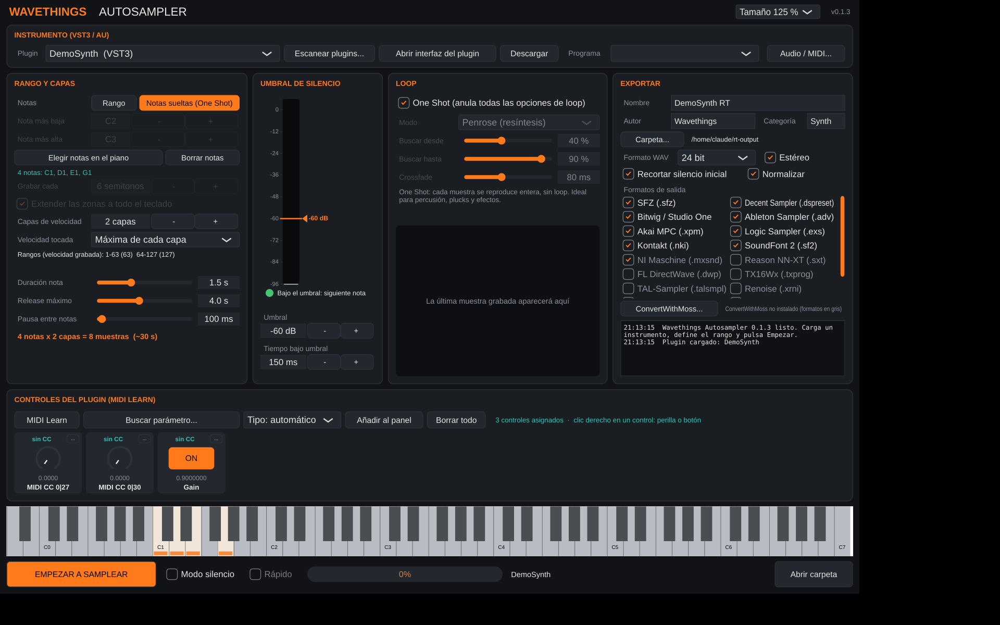

# Wavethings Autosampler 0.1.9

Autosampler para instrumentos **VST3 y Audio Units**. Lo cargas, tocas la nota más baja y la más alta en tu teclado MIDI, eliges capas de velocidad y tipo de loop, y Wavethings graba cada nota, busca los loops en cruces por cero y exporta el instrumento para los samplers más usados.

App independiente para **macOS (Intel + Apple Silicon), Windows y Linux**, compilada automáticamente con GitHub Actions.



---

## Funciones

**Instrumento**
- Carga plugins VST3 (macOS, Windows, Linux), AU (macOS) y LV2 (Linux).
- **Escaneo seguro:** cada plugin se analiza en un proceso aparte. Si uno se cierra o tarda más de 60 s, va a la lista negra y el escaneo continúa sin que la app se cierre.
- Si la app se cierra mientras carga un plugin, al volver a abrirla no lo carga de nuevo automáticamente.
- El instrumento suena **siempre** que tocas el controlador MIDI (salvo durante la grabación de cada nota, para no ensuciar las muestras).
- Selector de programas del plugin e interfaz del plugin en ventana aparte.

**Notas a samplear** — cuatro formas de elegirlas:
1. **Aprender (acorde):** toca a la vez la nota más baja y la más alta.
2. **Aprender baja / Aprender alta:** un botón para cada una (cómodo en teclados de pocas teclas: cambia de octava entre una y otra).
3. **Asistente:** ventana que te pide primero la nota más baja y luego la más alta.

4. **One Shot (notas sueltas):** eliges en el piano de la app (o tocando tu teclado MIDI) exactamente las notas a samplear, por ejemplo C1, D1, E1 y G1. Solo se graban esas, y cada muestra ocupa únicamente su tecla. Ideal para kits de batería y efectos.

Además: **grabar cada N semitonos** (1–24), opción de extender las zonas a todo el teclado, y un teclado en pantalla que muestra el rango y las notas que se van a grabar.

**Capas de velocidad**
- De 1 a 16 capas, calculadas automáticamente (rangos iguales en 1–127).
- Se puede elegir qué velocidad se toca en cada capa: la máxima, la central o la mínima.

**Detección del final de la nota**
- Umbral de silencio editable (en dB) con **medidor visible**: la línea naranja es el umbral (puedes arrastrarla) y el LED indica cuándo el sonido está por debajo, es decir, cuándo el sampler pasará a la siguiente nota.
- Tiempo mínimo bajo el umbral y release máximo como límite de seguridad.

**Loops** (siempre en cruces por cero para evitar clics)
- Botón **Loop** para activarlos o desactivarlos, y modo: **Forward**, **Backward**, **Ping-Pong** o **Penrose** (inspirado en la *Penrose Machine* de Logic: resintetiza un loop perfectamente periódico con el mismo carácter, afinado a la nota).
- Botón **Crossfade** independiente, con dos formas: **lineal** (lo mejor para sonidos sostenidos) o **curvada** (potencia constante, para sonidos que cambian), dibujadas como en la MPC. Longitud regulable y opción de aplicarlo en el audio o dejar que lo haga el sampler (MPC, Kontakt, Logic, Ableton, Bitwig, SFZ, Decent Sampler).
- Inicio y final del loop en % de la parte sostenida de la nota; los puntos exactos se buscan alrededor.
- Opción para igualar el nivel dentro del loop cuando el sonido va bajando.
- **One Shot** (en la sección Notas) es el modo de notas sueltas. El loop sigue disponible: sin loop, cada muestra suena entera aunque sueltes la tecla; con loop, se mantiene mientras pulsas.

Los loops se **renderizan en el propio audio** como un loop hacia delante, así que Backward y Ping-Pong suenan igual en cualquier sampler.

**MIDI Learn de parámetros del plugin**
- Pulsa *MIDI Learn*, mueve un control en la interfaz del plugin (o búscalo con **Buscar parámetro…**, escribiendo parte del nombre) y mueve un mando de tu controlador.
- Cada control puede ser **perilla** o **botón on/off** (elige el tipo antes de asignar, o clic derecho / botón «…» sobre el control). En modo automático, los parámetros de dos estados se convierten en botón. Con un botón, un CC ≥ 64 lo enciende y < 64 lo apaga.
- Los controles asignados aparecen como mandos en la ventana principal (también se pueden añadir sin CC). Ideal para apagar el delay o la reverb, o preparar variaciones entre programas.
- Las asignaciones se guardan por plugin.

**Interfaz y trabajo en segundo plano**
- **Tamaño de la interfaz** de 75 % a 200 % (selector arriba a la derecha, o Cmd/Ctrl + y Cmd/Ctrl −).
- **Modo silencio:** samplea sin que el instrumento suene por los altavoces, para seguir trabajando mientras graba.
- **Rápido** (con modo silencio): el plugin se renderiza más rápido que en tiempo real (modo offline). En las pruebas, 8 muestras que tardan ~30 s se hicieron en 3 s. Si algún plugin suena distinto o le faltan notas (por ejemplo librerías que cargan muestras desde disco), desactívalo.

**Audio**
- WAV de 16, 24 o 32 bit float, mono o estéreo, con chunk `smpl` (nota raíz + loop).
- Recorte del silencio inicial en un cruce por cero, compensación de la latencia del plugin y fundido final.
- Normalización opcional con **una sola ganancia para todo el instrumento**, para mantener las diferencias entre capas.
- El tiempo de release del plugin se mide y se escribe en la envolvente de cada formato.

---

## Formatos de exportación

| Formato | Para | Notas |
|---|---|---|
| **SFZ** (`.sfz`) | Reason NN-XT, Bitwig, Cubase/HALion, FL Studio, sforzando, TAL… | Formato abierto |
| **Decent Sampler** (`.dspreset`) | Decent Sampler (gratis) | Incluye interfaz con Attack/Decay/Sustain/Release/Volumen |
| **Bitwig / Studio One** (`.multisample`) | Sampler de Bitwig, Sample One XT / Presence XT de Studio One | Un solo archivo con las muestras dentro |
| **Ableton Sampler** (`.adv`) | Ableton Live 11/12 | Copia la carpeta `Ableton` a tu User Library |
| **Akai MPC 3.x** (`.xpm`) | MPC One/Live/X/Key, MPC Software 3.x | Formato moderno (JSON) creado a partir de un programa guardado por la MPC 3.10, con los samples en `<nombre>_[ProgramData]`. Hasta 8 capas por keygroup. Copia la carpeta `MPC` a tu MPC |
| Akai MPC 2.x (legacy) | MPC con firmware 2.x | Formato XML antiguo, solo si lo necesitas |
| **Logic Sampler** (`.exs`) | Logic Pro, MainStage | |
| **Kontakt** (`.nki`) | Kontakt | Formato Kontakt 1, el único documentado públicamente |
| **SoundFont 2** (`.sf2`) | FL Studio, Reason, Cubase, MuseScore, Kontakt (importación)… | 24 bit (`sm24`) |
| **NI Maschine** (`.mxsnd`), **Reason NN-XT** (`.sxt`), **FL DirectWave**, **TX16Wx**, **TAL-Sampler**, **Renoise**, **Korg wavestate**, **Deluge**, **OP-XY** | | A través de [ConvertWithMoss](https://github.com/git-moss/ConvertWithMoss) (ver abajo) |

### Formatos a través de ConvertWithMoss
Maschine y otros formatos son binarios propietarios que [ConvertWithMoss](https://github.com/git-moss/ConvertWithMoss) (gratuito, de Jürgen Moßgraber) ya sabe escribir. Si lo tienes instalado, Wavethings le pasa el instrumento en formato `.multisample` y lo convierte automáticamente. Wavethings lo busca en su ruta de instalación habitual; si no lo encuentra, pulsa **ConvertWithMoss…** y elige su ejecutable.

---

## Descarga

En la página **Releases** del repositorio están los paquetes de cada versión:

- **macOS:** `WavethingsAutosampler-…-macos-universal.zip`. La app no está firmada con un certificado de Apple: la primera vez abre el menú contextual (clic derecho) → **Abrir**, o ejecuta `xattr -cr "/Applications/Wavethings Autosampler.app"`.
- **Windows:** `WavethingsAutosampler-…-windows-x64.zip`. Si SmartScreen avisa: *Más información → Ejecutar de todas formas*.
- **Linux:** `WavethingsAutosampler-…-linux-x64.tar.gz` (necesita ALSA o JACK, y GTK3).

## Primeros pasos

1. **Audio / MIDI…**: elige la salida de audio y activa tu teclado MIDI.
2. **Escanear plugins…** → *Options → Scan for new or updated VST3 plug-ins* (y AudioUnit en Mac).
3. Elige el instrumento en la lista. Se abre su interfaz; toca el teclado para comprobar que suena.
4. Define el rango (acorde, botones o asistente), los semitonos y las capas.
5. Ajusta el umbral mirando el medidor: con el instrumento en silencio, el LED debe estar verde.
6. Elige el loop (o One Shot), el nombre y los formatos, y pulsa **EMPEZAR A SAMPLEAR**.

Resultado en `Documentos/Wavethings Autosampler/<nombre>/`:
```
<nombre>/
  Samples/                 WAV maestros (los usan SFZ y Decent Sampler)
  <nombre>.sfz
  <nombre>.dspreset
  <nombre>.multisample
  <nombre>.sf2
  Ableton/Presets/Instruments/Sampler/<nombre>.adv  +  Ableton/Samples/Imported/<nombre>/
  MPC/<nombre>/<nombre>.xpm + WAV
  Logic/<nombre>/<nombre>.exs + WAV
  Kontakt/<nombre>.nki + Kontakt/<nombre>/
  Maschine/ …              (si ConvertWithMoss está instalado)
```

**Consejos**
- Desactiva el delay y la reverb del plugin (MIDI Learn ayuda): las colas largas alargan cada nota y dificultan los loops.
- Para loops, deja una *Duración nota* de al menos 2–3 s. La búsqueda se hace en la parte sostenida.
- Si el plugin tiene ruido de fondo, sube el umbral hasta que el LED se ponga verde en silencio.

---

## Compilar desde el código

Requisitos: CMake ≥ 3.22, compilador C++17 (Xcode 14+, Visual Studio 2022, GCC 11+/Clang 14+). JUCE 8 se descarga solo.

```bash
cmake -B build -DCMAKE_BUILD_TYPE=Release
cmake --build build --config Release --parallel
./build/WavethingsTests_artefacts/Release/WavethingsTests   # tests (sin tarjeta de sonido)
```

En Linux instala antes:
```bash
sudo apt install libasound2-dev libjack-jackd2-dev ladspa-sdk libcurl4-openssl-dev libfreetype-dev \
  libfontconfig1-dev libx11-dev libxcomposite-dev libxcursor-dev libxext-dev libxinerama-dev \
  libxrandr-dev libxrender-dev libgtk-3-dev libglu1-mesa-dev mesa-common-dev
```

Universal binary en macOS: `-DCMAKE_OSX_ARCHITECTURES="arm64;x86_64"`.
Para usar una copia local de JUCE: `-DJUCE_DIR=/ruta/a/JUCE`.

### Subirlo a GitHub y generar las apps (GitHub Desktop)

1. En GitHub Desktop: **File → Add Local Repository…** y elige esta carpeta (o, si ya tienes el repositorio, copia estos archivos dentro).
2. Escribe un resumen abajo a la izquierda y pulsa **Commit to main**.
3. Pulsa **Push origin** (la primera vez, **Publish repository**).
4. **Repository → View on GitHub → Actions**: en 10–20 minutos aparecen las apps de Mac, Windows y Linux en *Artifacts*.

Para publicar una versión en **Releases**: pestaña **History**, clic derecho en el último commit → **Create Tag…** → `v0.1.2` → **Push origin**.

### Estructura del código
```
Source/Core/     motor de audio y host de plugins, escaneo fuera de proceso, MIDI learn, sampleo, DSP de loops, WAV
Source/Export/   un archivo por formato + puente a ConvertWithMoss
Source/UI/       look & feel, medidor, forma de onda, panel de controles, asistente de rango
Tests/           test de consola: sesiones completas con un sintetizador interno y con un VST3 real
```

---

## Hoja de ruta (0.2)
- Maschine nativo (sin ConvertWithMoss) y `.sxt` nativo.
- Round robin (varias tomas por nota) y crossfade entre capas de velocidad.
- Sampleo por lotes de varios programas del plugin.
- Detección automática de la afinación para el modo Penrose en instrumentos desafinados.

## Licencia y créditos
- Wavethings Autosampler se distribuye bajo **GNU AGPL v3** (ver `LICENSE`), la licencia libre de [JUCE 8](https://juce.com).
- Las plantillas de Ableton (`.adv`) y Kontakt 1 (`.nki`) y la estructura de los formatos MPC y EXS proceden de [ConvertWithMoss](https://github.com/git-moss/ConvertWithMoss) © Jürgen Moßgraber, LGPL-3.0. Ver `THIRD_PARTY_NOTICES.md`.
- VST es una marca registrada de Steinberg Media Technologies GmbH. Audio Units, Logic y MainStage son marcas de Apple Inc. Kontakt y Maschine son marcas de Native Instruments. El resto de marcas pertenecen a sus propietarios.
